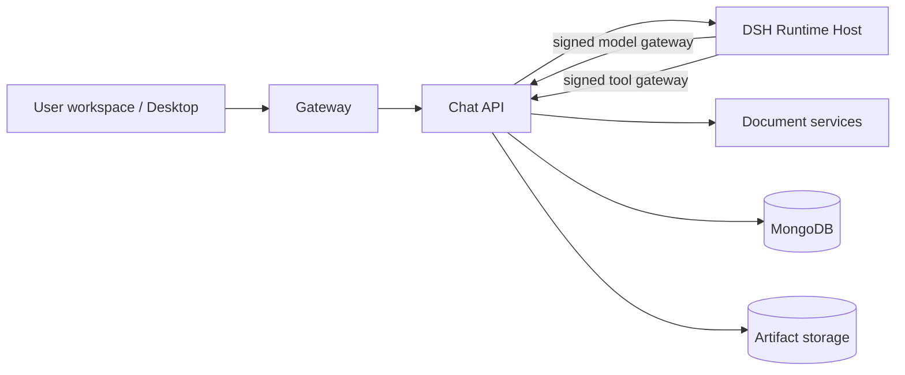

# UTECH Chat API

The conversation and policy backend for [UTECH](../../README.md), the self-hosted
enterprise Agent platform built on DeepSeek Harness (DSH).

`chat-api` is the system of record and policy plane for MOVO. It owns
authentication and tenancy, conversation orchestration, model access, tool and
Skill policy, evidence persistence, and file delivery. The actual agent loop is
executed by the out-of-process DSH Runtime Host; `chat-api` supplies the runtime
profile and serves the signed model and tool gateways that the host calls back
into.



## What this service does

- **Conversation orchestration** — sessions, turns, cancellation, recovery,
  retries, and durable event projection for live streaming and reconnects.
- **DSH integration** — implements the `AgentKernelContract` over HTTP, compiles
  an immutable per-tenant runtime profile (models, tools, Skills, plugins, search
  availability), and manages runtime/session bindings.
- **Model gateway** — exposes `/internal/dsh/model/generate` so the DSH host can
  call configured providers through MOVO's credential, routing, quota, and
  policy boundaries instead of contacting providers directly.
- **Tool gateway** — exposes `/internal/dsh/tools` for tool calls, approvals,
  sandbox execution, audit records, and result delivery.
- **Skills and plugins** — Skill authoring, validation, packaging, installation,
  sharing, lifecycle management, and DSH plugin/skill bundle distribution.
- **Knowledge and research** — knowledge sources, retrieval, citations,
  evidence handling, deep research, and enterprise capability adapters.
- **Content and documents** — document parsing integration, generated
  deliverables, spreadsheets, presentations, PDF/DOCX editing, and artifact
  storage.
- **Collaboration** — session sharing, participants, read-only snapshots, and
  live session event streams.
- **Automation** — persistent scheduled jobs with run history and manual runs.
- **Governance and accounting** — approval and suspension flows, audit events,
  token usage, quotas, and per-tenant access policy.
- **Desktop bridge** — runtime profiles, capability checks, session commits,
  desktop turn operations, and question/answer handling for MOVO Desktop.
- **Operations** — structured logging, request context, health/readiness
  endpoints, additive migrations, and localized API errors.

## Module map

| Path | Responsibility |
| --- | --- |
| `app/main.py` | FastAPI application, middleware, router mounting, startup indexes |
| `app/api/endpoints/` | HTTP endpoints grouped by domain (sessions, chat, Skills, knowledge, quota, …) |
| `app/dsh_runtime/` | Agent kernel contract, DSH host transport, turn lifecycle, event mapping, profiles, gateways |
| `app/enterprise_capabilities/` | Knowledge, research, content, browser, artifacts, delivery, and other Agent tools |
| `app/knowledge/` | Retrieval, citations, prompting, research focus, and Skill catalog integration |
| `app/llm/` | Provider abstractions, model routing, configured models, image/vision runtimes |
| `app/tools/` | Document, PDF, DOCX, and infographic tooling |
| `app/services/` | Sharing, Skill packages/lifecycle, presentation, RAG, translation, feedback |
| `app/execution_isolation/` | Sandbox execution, personal spaces, script approval policy, audit access |
| `app/scheduled_tasks/` | Persistent scheduled job scheduler |
| `app/token_usage/` | Token usage accounting and optional push delivery |
| `app/governance/` | Suspensions and approval governance |
| `app/product/` | Product-extension seams for Community vs. commercial distributions |
| `app/infrastructure/` | Observability, request context, execution events, runtime services |
| `app/migrations/` | Additive MongoDB migrations and sequence repair |
| `app/core/` | Settings, MongoDB lifecycle, authentication, tenant and quota policy |
| `dsh/` | Pinned DSH runtime assets, runtime host, compatible versions, and SBOM |
| `scripts/` | DSH guards, upgrade tooling, benchmarks, probes, and maintenance scripts |

### Agent execution flow

1. A client calls a `/api/...` endpoint. `chat-api` authenticates the end user or
   desktop principal and resolves the tenant.
2. Turn admission checks quota, model access, session state, and cancellation
   before accepting work.
3. The runtime profile is compiled from the tenant's model, tool, Skill,
   plugin, and search configuration, then published as an immutable snapshot.
4. `chat-api` creates or reuses a DSH runtime and session through
   `app/dsh_runtime/`.
5. The DSH Runtime Host runs the agent loop and calls back through the signed
   model and tool gateways for every model request and tool invocation.
6. Turn events are persisted and projected into live streams, snapshots, and
   history so clients can reconnect without losing state.
7. Finalization records usage, evidence, artifacts, audit events, and delivery
   metadata.

## HTTP API

The service listens on `:8000`. Interactive OpenAPI documentation is available
at `/docs` (and `/redoc`) when the service is running.

| Prefix | Purpose |
| --- | --- |
| `/api/auth` | End-user login, tenant switching, profile, admin SSO |
| `/api/sessions` | Session lifecycle, search, messages, snapshots |
| `/api/chat` | Chat completions, uploads, cancellation, event queries |
| `/api/desktop/dsh` | Desktop runtime profiles, capability checks, turn operations |
| `/api/tasks` | Task suspension, browser auth, resume |
| `/api/skills` | Skill authoring, validation, execution, and management |
| `/api/dsh-plugins` | DSH plugin management |
| `/api/knowledge-*` | Knowledge sources, references, and source configuration |
| `/api/documents`, `/api/files` | Document editing and artifact delivery |
| `/api/models` | Available models and model connectivity tests |
| `/api/projects` | Code project listings |
| `/api/quota`, `/api/token-usage` | Quota and usage accounting |
| `/api/scheduled-jobs` | Scheduled task CRUD and run history |
| `/api/session-shares` | Session sharing and participants |
| `/api/session-snapshots` | Read-only conversation snapshots |
| `/api/sessions/{id}/live` | Live session event stream |
| `/internal/dsh/model/generate` | Signed model gateway used by the DSH host |
| `/internal/dsh/tools` | Signed tool gateway used by the DSH host |
| `/internal/dsh/plugin-archives`, `/internal/dsh/skill-bundles` | Internal artifact delivery |
| `/internal/sandbox-audits` | Internal sandbox audit access |

`/internal/*` routes are service-to-service only. They require the configured
service token or gateway signing secret and must never be exposed publicly.

Operational endpoints:

- `GET /health` — liveness and DSH host status.
- `GET /ready` — readiness; returns `503` when the DSH Runtime Host is
  unavailable.

## Running locally

For the full platform, prefer the repository-level development scripts:

```bash
./dev.sh        # user-web, chat-api, admin-api, document-api, and workers
./dev_dsh.sh    # additionally starts the pinned DSH Runtime Host on :8101
```

`dev.sh` creates `services/chat-api/venv`, installs requirements on demand,
generates shared internal-service credentials, and starts chat-api on `:8000`.
The Vite dev server proxies `/api` and `/askai-api` to this service.

To run only this service:

```bash
cd services/chat-api
python3 -m venv venv
source venv/bin/activate
pip install -r requirements.txt

cp .env.example .env    # set MONGODB_URI and required auth secrets
uvicorn app.main:app --reload --port 8000
```

Chat endpoints and `/ready` require a reachable DSH Runtime Host. Without
`./dev_dsh.sh`, start the host separately or configure `DSH_RUNTIME_HOST_URL`.

Runtime dependencies are canonical in `requirements.txt`. `pyproject.toml` is
metadata only and is not the install source used by Docker or deployments.

### Configuration

Configuration is environment based; see [`.env.example`](.env.example) for the
full list. The most important groups are:

| Group | Variables |
| --- | --- |
| Core | `MONGODB_URI`, `MONGODB_DB`, `ALLOWED_ORIGINS`, `DEBUG`, `LOG_*` |
| Internal auth | `END_USER_AUTH_SECRET`, `ADMIN_BACKEND_SERVICE_TOKEN`, `ASKAI_ADMIN_JWT_SECRET`, `ADMIN_API_BASE_URL` |
| DSH | `DSH_RUNTIME_HOST_URL`, `DSH_RUNTIME_HOST_TOKEN`, `DSH_MODEL_GATEWAY_SIGNING_SECRET`, `DSH_MODEL_GATEWAY_URL`, `DSH_TOOL_GATEWAY_URL`, `DSH_RUNTIME_STORAGE_ROOT` |
| Model providers | `OPENAI_*`, `AZURE_*`, `QWEN_*`, `DASHSCOPE_*`, `VISION_*` |
| Search and data | `SERPAPI_*`, `SERPER_API_KEY`, `TAVILY_API_KEY`, `BAIDU_QIANFAN_*`, `ARK_*`, `TUSHARE_TOKEN`, `TIANYANCHA_TOKEN` |
| Knowledge and documents | `DOCUMENT_PROCESSING_BASE_URL`, `KNOWLEDGE_CANDIDATES_*`, `KNOWLEDGE_STORAGE_TYPE`, `KNOWLEDGE_LOCAL_STORAGE_DIR` |
| Storage | `STORAGE_BACKEND`, `LOCAL_STORAGE_PATH`, `FILE_PUBLIC_*`, `BACKEND_INTERNAL_BASE_URL`, `OSS_*` |
| Sandbox | `SANDBOX_PROVIDER`, `ALIYUN_AIO_*`, `MOVO_SANDBOX_*` |
| Limits | `MAX_UPLOAD_IMAGE_BYTES`, `MAX_UPLOAD_DOCUMENT_BYTES`, `MAX_UPLOAD_SKILL_SOURCE_BYTES`, `MAX_UPLOAD_TEMPLATE_BYTES` |

In Docker Compose, shared secrets are generated by the one-shot `bootstrap`
service and sourced from `/run/askai-secrets/runtime.env`. Source-mode
development generates equivalent values under `.movo-dev/` through
`scripts/dev/internal_service_auth.sh`. Model-provider credentials configured
through the admin console are encrypted with `ASKAI_ADMIN_JWT_SECRET`, which must
match across admin-api, document-api, and the worker.

Legacy `ASKAI_*` environment variables and module names are intentionally
retained. Newer `MOVO_*` names are aliases in many places; check both spellings
when changing configuration.

### Docker Compose

The service is built from [`Dockerfile`](Dockerfile) and runs as the `chat-api`
service in the root [`docker-compose.yml`](../../docker-compose.yml). Start the
platform from the repository root:

```bash
./movo up            # prebuilt images
./movo up --build    # build from source
./movo logs chat-api
```

Inside Compose, `chat-api` talks to `mongo`, `admin-api`, `document-api`, and
`dsh-runtime-host` over the backend network. Persistent volumes hold artifact
storage, knowledge documents, DSH runtime data, sandbox workspaces, and offline
packages.

## Migrations

Migrations are additive and live in `app/migrations/`:

```bash
cd services/chat-api
python -m app.migrations
```

Application startup also ensures service-specific MongoDB indexes. During an
upgrade, `./movo update` runs migrations before replacing a running chat-api;
`./movo fix` runs `python -m app.migrations.sequence_repair` when sequence
conflicts are reported.

## Testing

The chat-api suite requires a real MongoDB and fails rather than skipping when
it is unreachable. Each test uses an isolated `movo_test_<uuid>` database.

```bash
docker run -d --name movo-test-mongo -p 27017:27017 mongo:6.0.20

# from the repository root
pip install -r services/chat-api/requirements.txt pytest
PYTHONPATH=services/chat-api python -m pytest services/chat-api/tests -q
PYTHONPATH=services/chat-api python -m pytest services/chat-api/tests/services -q
PYTHONPATH=services/chat-api python -m pytest services/chat-api/tests/services/test_skill_sharing.py -q
```

Set `MOVO_TEST_MONGODB_URI` to override the test URI.

DSH Runtime Host tests:

```bash
cd services/chat-api/dsh/runtime-host
pnpm install --frozen-lockfile
pnpm test
```

Repository guards that protect the DSH boundary and dependency locks:

```bash
python services/chat-api/scripts/check_dsh_legacy_runtime_boundary.py
python services/chat-api/scripts/check_dsh_native_code_boundary.py
python services/chat-api/scripts/check_dsh_supply_chain.py
python services/chat-api/scripts/check_dsh_upgrade_contract.py
```

## DSH version policy

The DSH release train is pinned in `dsh/versions.lock`,
`dsh/compatibility-matrix.yaml`, `dsh/sbom.cdx.json`, and
`dsh/runtime-host/pnpm-lock.yaml`. Do not hand-bump these files or mix DSH
release trains. Use the tooling under `scripts/dsh_upgrade/`, keep the guard
scripts green, and document any change to the approved DSH version.

## Development guidelines

### DSH boundary

- Do not modify DSH source code or files under `services/chat-api/dsh/`,
  including the Runtime Host wrapper, presets, tests, and installed packages.
- Fix MOVO behavior in `services/chat-api/app/` and its tests. Use supported DSH
  APIs and keep integration logic in small, focused modules.
- If a change appears to require a DSH source edit, document the missing API or
  capability and review the boundary before implementation. Do not patch vendored
  code.

### Code language

- Use English for identifiers, variable names, function names, class names,
  comments, docstrings, log messages, test names, and internal keys.
- Do not use Chinese text as an identifier, translation key, or code comment.
- User-facing Chinese belongs in the localization resources or other explicit
  presentation data. Keep stable localization keys in English.
- Existing Chinese content does not authorize adding new Chinese code
  annotations; update affected annotations when editing nearby code.

### Module boundaries

- Do not create or expand giant files. Separate endpoints, orchestration,
  integrations, and domain behavior into focused modules.
- Keep endpoint and entry modules thin; give each extracted module a clear
  responsibility and interface.
- When changing a large existing file, extract the affected responsibility
  instead of adding another large block. Preserve behavior and run relevant
  tests.
- Keep product-specific behavior behind the extension seams in `app/product/`
  rather than branching inline.

## Related documentation

- [Repository README](../../README.md) — platform overview and deployment
- [CLAUDE.md](../../CLAUDE.md) — repository-wide architecture and commands
- [CONTRIBUTING.md](../../CONTRIBUTING.md) — contribution process
- [SECURITY.md](../../SECURITY.md) — security policy
- [`dsh/runtime-host/`](dsh/runtime-host/) — Node.js DSH Runtime Host
